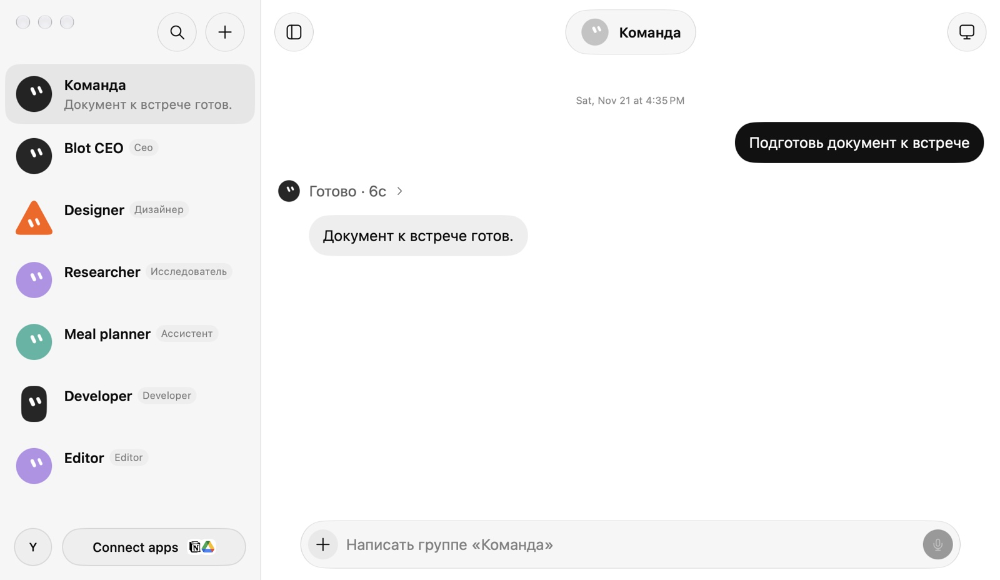
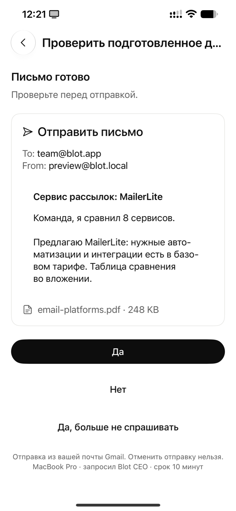
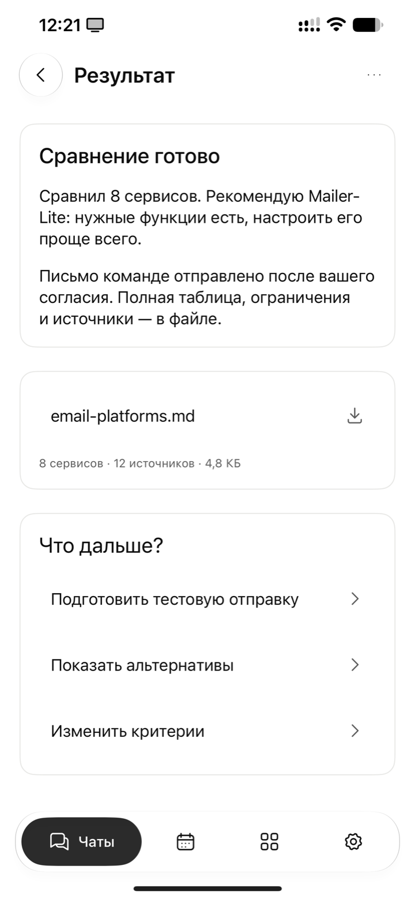
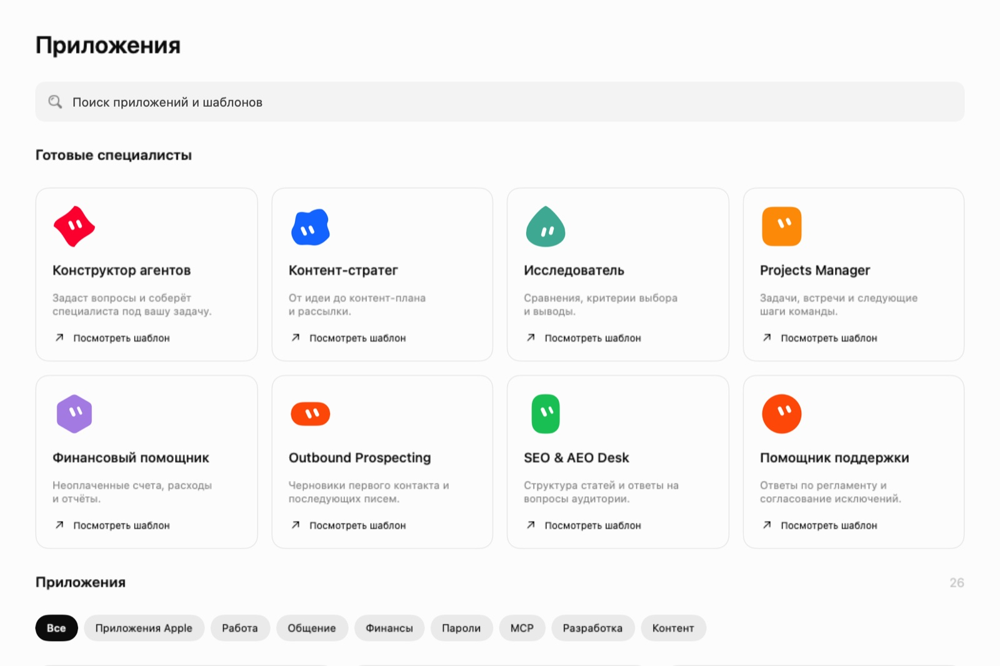

# Ori

**An AI workspace for Mac and iPhone.**

Give an agent a task in chat, or bring specialists together in a group with a coordinator. Ori keeps the conversation, attached files, and results in the workspace. When an action requires approval, you can review what the agent proposes before it runs.

[Beta downloads](https://github.com/Hqzdev/blot-releases/releases) · [Screenshots](#screenshots) · [Build from source](#build-from-source) · [Documentation](docs/README.md)

[](assets/readme/mac-team-chat.jpg)

*macOS · A group conversation with a shared task. Captured in a development build with sample data.*

## What you can do

- **Build a team.** Set up agents with their own roles, instructions, and models. Chat with one agent directly or give a group a task to work on together.
- **Keep work with the conversation.** Attach a file, follow the agent’s progress, and open the resulting document from the chat.
- **Review actions before they run.** With Ask First enabled, review details such as an email’s recipient, draft, and attachment before deciding whether to send it.
- **Give agents tools for recurring work.** Configure schedules and connect services through app integrations or MCP. Availability depends on the device, connected service, and permissions.

## Screenshots

### iPhone · Review an action and open the result

<p align="center">
  <a href="assets/readme/iphone-approval.png"></a>
  <a href="assets/readme/iphone-result.png"></a>
</p>

*Captured on an iPhone 13 Pro Max in preview mode. The drafts and results use sample data.*

<details>
<summary>Mac agent catalog</summary>

[](assets/readme/mac-agent-catalog.jpg)

*Agent templates and integration categories in the macOS development preview.*

</details>

## Try the beta

See [GitHub Releases](https://github.com/Hqzdev/blot-releases/releases) for installers and release notes.

| Platform | Installation |
| --- | --- |
| **Mac** | Apple Silicon and macOS 26+. Open the DMG and drag Ori into Applications. The beta is ad hoc signed and distributed without Apple notarization. |
| **iPhone** | iOS 26+. Sign the IPA with your own Apple developer identity before installing it on your device. |

To try a conversation, add your model credentials, select that model in the agent’s settings, and give the agent a task in chat. Android and Windows are on the roadmap. Background schedule execution and parts of device sync are still in development.

## Build from source

```bash
git clone https://github.com/Hqzdev/ori-agent.git
cd ori-agent
```

### Apple apps

Use Xcode with the macOS and iOS 26 SDKs and Swift 6.2 or later. The Mac build also requires JDK 25 to package the local backend.

- **Mac** — Open [`apps/Blot.xcodeproj`](apps/Blot.xcodeproj) and run the **BlotMac** scheme. From the repository root, `./script/build_and_run.sh` builds and launches the app. Use `--build-only` to build or `--design` to open the team demo with sample data.
- **iPhone** — Select **BlotIOS** in the same Xcode project, configure your signing team, and run on a connected physical iPhone.

### Website

Use Node.js 24 and npm. Run these commands from the repository root.

```bash
cd landing
npm ci
npm run dev
```

Open [localhost:3000](http://localhost:3000). The site includes the product pages, documentation, and the development roadmap at `/workspace`. See the [website guide](landing/README.md) for configuration.

### Java backend and account service

Use JDK 25 and the included Gradle Wrapper. Environment variables for the database, models, email, and account service are in [`.env.example`](.env.example).

```bash
# Local API
./backend/gradlew -p backend :api:bootRun

# Separate account service
./scripts/run-cloud.sh
```

See the [backend guide](backend/README.md) and [installation and environment guide](docs/status/installation-environment.md).

## Repository guide

| Path | What lives there |
| --- | --- |
| [`apps/macos/`](apps/macos/), [`apps/ios/`](apps/ios/), [`apps/shared/`](apps/shared/) | SwiftUI clients and shared Apple interface. |
| [`packages/`](packages/) | Swift packages for the SQLite workspace, domain and API models, design, and graph. |
| [`backend/`](backend/) | Java API, application services, infrastructure, and account service. |
| [`landing/`](landing/) | Next.js product website, documentation pages, and browser-based account flow. |
| [`contracts/`](contracts/), [`fixtures/`](fixtures/) | Shared API schemas and verification data. |

### Checks

```bash
swift test --package-path packages/BlotWorkspace
./backend/gradlew --no-daemon -p backend --dependency-verification=strict spotlessCheck check
```

For website checks, run `npm run test:plan`, `npm run test:auth`, and `npm run build` from `landing/`. See the [CI workflow](.github/workflows/ci.yml) for the Java-to-Swift fixture checks and Apple build commands.

## Documentation

- [Product specification and acceptance criteria](docs/product/blot-technical-specification.md)
- [Module map](docs/architecture/module-map.md) and [v3 contracts](contracts/v3/README.md)
- [Permissions and approvals](docs/rules/permission-policy.md) and [MCP developer guide](docs/integrations/mcp-developer-guide.md)
- [Verification notes and evidence](docs/status/)
- [Report a bug](https://github.com/Hqzdev/ori-agent/issues)
