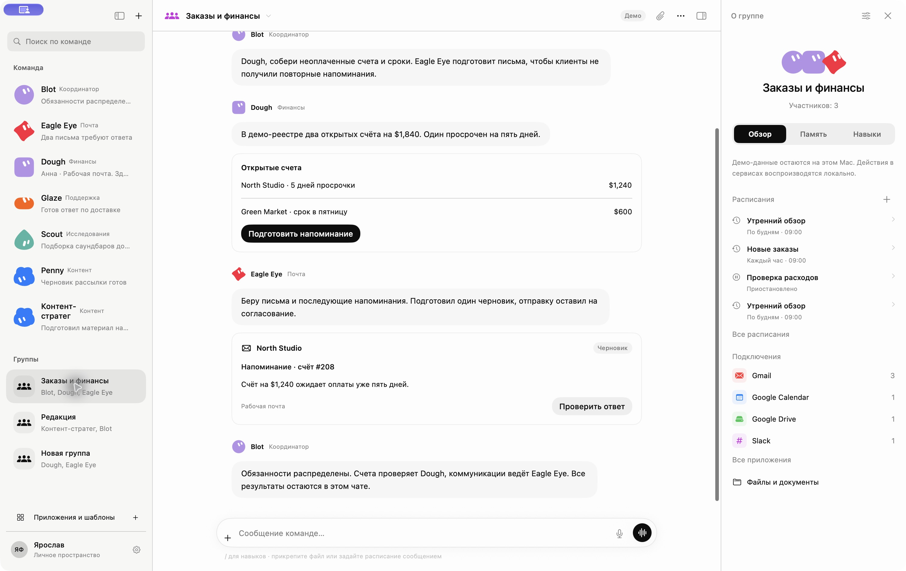
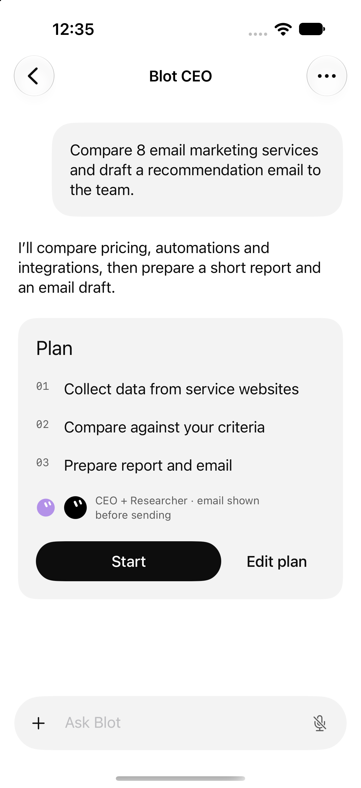
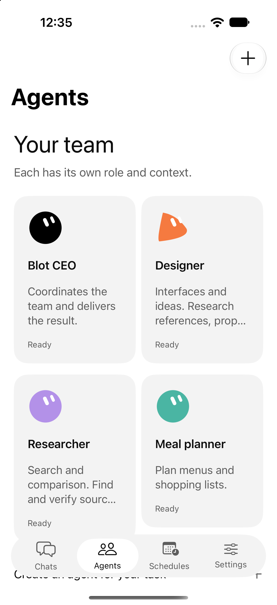
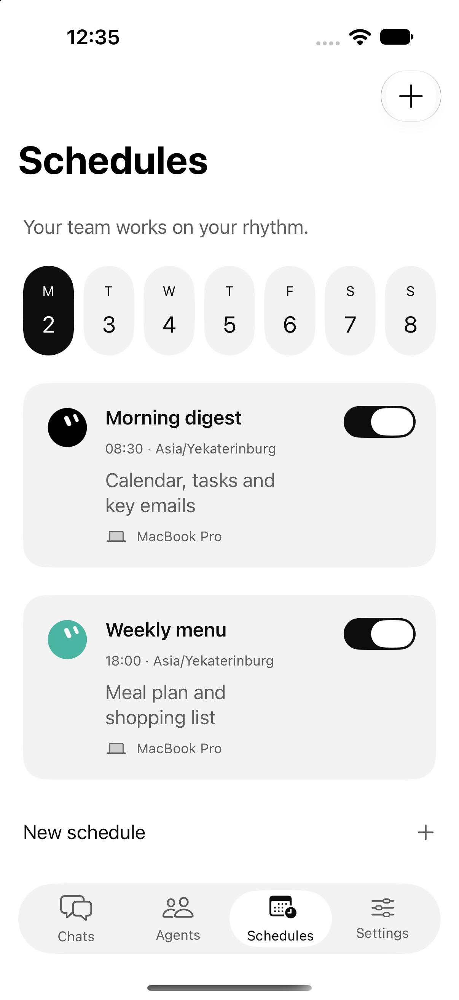
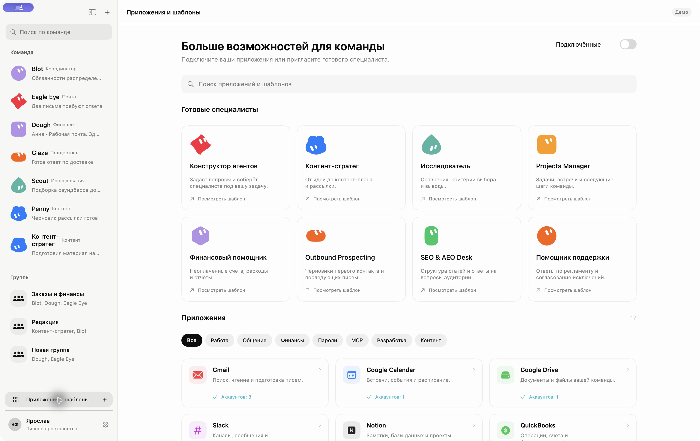
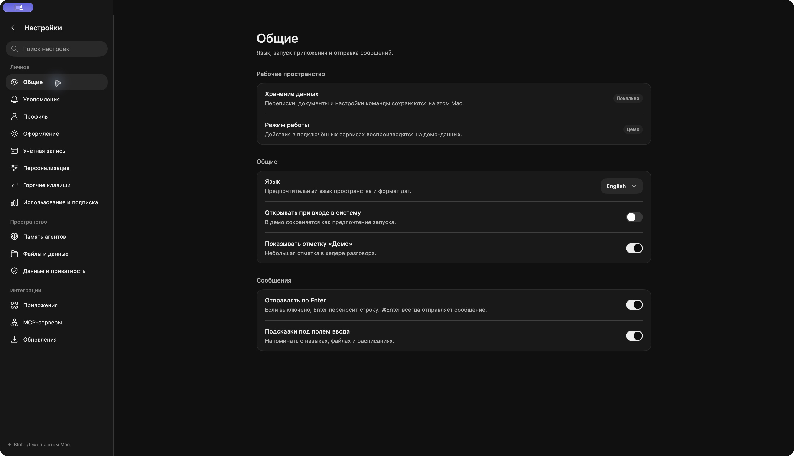
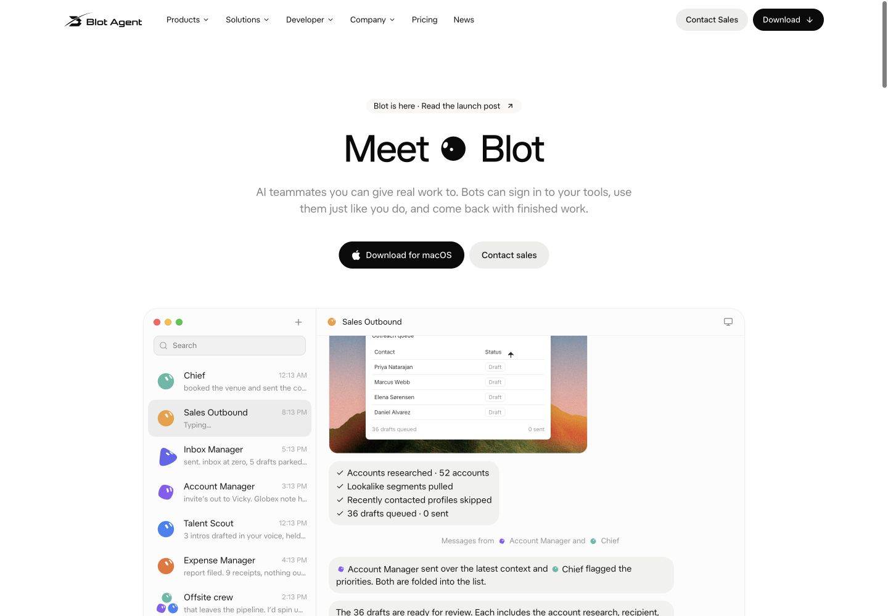

<p align="center">
  
</p>

<p align="center">
  <a href="#скриншоты">Интерфейс</a> ·
  <a href="#быстрый-старт">Быстрый старт</a> ·
  <a href="#архитектура">Архитектура</a> ·
  <a href="#проверки">Проверки</a> ·
  <a href="docs/README.md">Документация</a>
</p>

# Blot

**Одна задача. Команда агентов. Результат в вашем рабочем пространстве.**

Blot — разрабатываемый ИИ-помощник с нативными приложениями для Mac и iPhone. Идея продукта: вы ставите задачу в чате, координатор подключает агентов с нужными ролями, а планы, файлы и действия собираются в одном месте. Здесь находятся исходники приложений, локальных сервисов, сайта и контрактов.

<p align="center">
  
</p>

<p align="center"><sub>Командный чат на macOS. Снимок локального демо: внешние сервисы и действия воспроизводятся на тестовых данных.</sub></p>

## Что внутри

| Область | Назначение |
| --- | --- |
| **Команда агентов** | Координатор и специалисты со своими именами, ролями, инструкциями и образами. |
| **Чаты и группы** | Личные разговоры, обсуждение задачи несколькими агентами и просмотр результатов. |
| **Файлы и контекст** | Вложения, документы, память и навыки рядом с перепиской. |
| **Согласование действий** | Просмотр подготовленного действия до выполнения; модели разрешений и правил. |
| **Расписания** | Интерфейсы повторяющихся задач, напоминаний и выбора исполнителя. |
| **Подключения** | Интерфейсы сервисов и MCP, конфигурация моделей и учётных записей. |

Это карта возможностей проекта. Готовность конкретного сценария зависит от подключённого сервиса и режима запуска.

## Скриншоты

### iPhone · задача, команда, расписание

<p align="center">
  
  
  
</p>

<p align="center"><sub>Снимки каталога Apple v3 с тестовыми данными. Экраны показывают интерфейс; функциональная приёмка проводится отдельно.</sub></p>

<details>
<summary><strong>Ещё скриншоты: каталог агентов, тёмная тема и сайт</strong></summary>

### macOS · агенты и подключения



### macOS · настройки в тёмной теме



### Веб · лендинг Blot



</details>

Исходные макеты — в [`screens/`](screens/) и [`agent.pen`](agent.pen). Снимки запущенных интерфейсов и отчёты проверок — в [`docs/status/verification/`](docs/status/verification/).

## Статус разработки

Проект находится в активной разработке. В репозитории есть SwiftUI-клиенты, Swift-пакет рабочего пространства с SQLite, Java backend и сервис аккаунтов, а также сайт Next.js с кодом авторизации. Демо команды на Mac работает отдельно от обычного режима приложения.

| Часть | Состояние в репозитории |
| --- | --- |
| **macOS и iOS** | Исходники нативных приложений, общий интерфейс v3 и каталог предпросмотра в Debug. |
| **Рабочее пространство** | Сервисы чатов, агентов, файлов, задач, разрешений, памяти и синхронизации; компонентные тесты. |
| **Backend и аккаунты** | Модули локального Java-сервера, отдельный `cloud`, веб-авторизация и передача сессии в приложение. |
| **Сайт** | Лендинг, страницы продукта, документация и проектный `/workspace`. |
| **Android и Windows** | Целевые платформы в ТЗ и макетах; нативных приложений в этом репозитории пока нет. |
| **Выпуск** | Инструкции ниже предназначены для разработки из исходников; готовность релиза оценивается по матрице приёмки. |

Готовность экранов, успешная сборка и тесты компонентов проверяют разные части продукта. Полный сценарий с реальной моделью, почтой, подключениями и физическим iPhone требует отдельной проверки. Основные требования и BLOT-01…30 описаны в [ТЗ от 1 ноября 2026](docs/product/blot-technical-specification.md); история проверок — в [`docs/status/`](docs/status/).

## Быстрый старт

### Получить исходники

```bash
git clone https://github.com/Hqzdev/kiln-agent.git
cd kiln-agent
```

### Окружение

| Компонент | Что потребуется |
| --- | --- |
| Сайт | Node.js 24 и npm, как в CI. |
| Приложения Apple | macOS, Xcode с SDK macOS/iOS 26 и Swift 6.2 или новее. Для упаковки Java backend нужен JDK 25. |
| Backend / сервис аккаунтов | JDK 25; Gradle Wrapper находится в репозитории. |
| Проверки схем | Python 3 и `jsonschema==4.26.0`. |

При первой установке зависимостей нужна сеть. Приложения рассчитаны на **macOS 26+** и **iOS 26+**.

### Сайт и документация

```bash
cd landing
npm ci
npm run dev
```

Откройте [localhost:3000](http://localhost:3000). Главная страница показывает продукт, `/docs` — документацию, `/workspace` — план разработки. Проектный `/workspace` служит навигацией по задачам и ТЗ; запуск агентных задач находится в приложении.

`npm run build` обновляет скачиваемое ТЗ и копии документации, затем собирает Next.js. Для работы серверной авторизации нужны дополнительные параметры окружения.

### Mac

Откройте [`apps/Blot.xcodeproj`](apps/Blot.xcodeproj), выберите схему **BlotMac** и запустите приложение. Либо из корня репозитория:

```bash
./script/build_and_run.sh
```

Скрипт собирает приложение, проверяет наличие встроенного Java backend и запускает Blot. Доступны отдельные режимы:

```bash
# Собрать без запуска
./script/build_and_run.sh --build-only

# Запустить локальное демо команды на тестовых данных
./script/build_and_run.sh --design
```

### iPhone и симулятор

В том же Xcode-проекте выберите схему **BlotIOS** и доступный симулятор iOS 26+. Для физического iPhone настройте команду подписи в Xcode.

Каталог экранов доступен в Debug. Для открытия конкретного экрана v3 добавьте в **Scheme → Run → Arguments**:

```text
--workspace-preview --screen 10-chat-with-ceo
```

Имена экранов совпадают с файлами в [`screens/ios/`](screens/ios/); для Mac используйте [`screens/desktop/`](screens/desktop/), например `05-new-task`. Предпросмотр использует fixtures и не выполняет внешние действия.

### Java backend и аккаунты

Из корня репозитория:

```bash
# Локальный API
./backend/gradlew -p backend :api:bootRun

# Отдельный сервис аккаунтов для разработки
./scripts/run-cloud.sh
```

Параметры SMTP, моделей, Google OAuth, базы и адресов сервисов собраны в [`.env.example`](.env.example). При необходимости создайте локальный `.env` и заполните параметры выбранного сценария. Не добавляйте ключи и локальные базы в Git. Для личных Debug-сборок настройки GigaChat могут включаться в `.app` — учитывайте это перед передачей сборки.

Подробности: [backend](backend/README.md), [окружение](docs/status/installation-environment.md), [конфигурация Apple-сборок](scripts/apple_build_configuration.py).

## Архитектура

| Слой | Ответственность | Исходники |
| --- | --- | --- |
| **Apple-клиенты** | Навигация, экраны, ввод пользователя и представление состояния. | [`apps/`](apps/) |
| **Общие Swift-пакеты** | Домен, API, дизайн, граф и сервисы рабочего пространства. | [`packages/`](packages/) |
| **Локальный backend** | Доменная логика Java, сценарии, системные адаптеры и HTTP API. | [`backend/`](backend/) |
| **Аккаунты** | Java-модуль `cloud` и серверные модули веб-авторизации. | [`backend/cloud/`](backend/cloud/), [`landing/lib/auth/`](landing/lib/auth/), [`landing/lib/accounts/`](landing/lib/accounts/) |
| **Контракты** | OpenAPI, JSON Schema и общие проверочные данные. | [`contracts/`](contracts/), [`fixtures/`](fixtures/) |
| **Веб** | Next.js, React, сайт продукта и публикация документации. | [`landing/`](landing/) |

Java backend разделён на `core`, `application`, `infrastructure`, `api` и `cloud`. Общие Swift-пакеты: `BlotDomain`, `BlotAPI`, `BlotDesign`, `BlotGraph`, `BlotWorkspace`.

Код следует принципам единственной ответственности, инкапсуляции и композиции. Распределение обязанностей и целевая архитектура описаны в [карте модулей](docs/architecture/module-map.md); версии сущностей и API — в [`contracts/v3/`](contracts/v3/).

```text
apps/           Mac/iPhone-клиенты и общий SwiftUI-интерфейс
packages/       Переиспользуемые Swift-пакеты и их тесты
backend/        Java-модули, Gradle Wrapper и серверные тесты
landing/        Сайт, веб-авторизация и проектный workspace
contracts/      Контракты API и схемы сущностей
fixtures/       Общие тестовые данные
docs/           ТЗ, архитектура, правила и отчёты проверок
screens/        Макеты экранов по платформам
scripts/        Проверки и подготовка окружения
script/         Сборка и запуск Mac-приложения
```

## Проверки

Команды запускаются из корня, если явно не указан переход в папку.

<details open>
<summary><strong>Сайт: план, авторизация и сборка</strong></summary>

```bash
cd landing
npm run test:plan
npm run test:auth
npm run build
```

</details>

<details>
<summary><strong>Swift: домен, рабочее пространство и дизайн</strong></summary>

```bash
swift test --package-path packages/BlotDomain
swift test --package-path packages/BlotWorkspace
swift test --package-path packages/BlotDesign
swift test --package-path packages/BlotGraph
```

`BlotAPI` использует HTTP-фикстуры из Java-проверок:

```bash
BLOT_HTTP_FIXTURES="$PWD/.build/http-fixtures" swift test --package-path packages/BlotAPI
```

</details>

<details>
<summary><strong>Java: форматирование, зависимости, тесты и JAR</strong></summary>

```bash
./backend/gradlew --no-daemon -p backend --dependency-verification=strict spotlessCheck check :api:bootJar
```

Java HTTP-тесты сохраняют данные для `BlotAPI` в `.build/http-fixtures`.

</details>

<details>
<summary><strong>Python: конфигурация Apple и схемы v3</strong></summary>

```bash
python3 -m unittest discover -s scripts/tests
python3 -m venv .build/schema-venv
.build/schema-venv/bin/python -m pip install jsonschema==4.26.0
.build/schema-venv/bin/python scripts/check-v3-schemas.py
```

</details>

CI настроен в [`.github/workflows/ci.yml`](.github/workflows/ci.yml): сайт, Java, общие Swift-пакеты и Apple-сборки. Для задачи Apple нужен настроенный self-hosted runner. Результаты конкретного запуска доступны на вкладке [Actions](https://github.com/Hqzdev/kiln-agent/actions).

## Документация

| Начать с… | Для чего |
| --- | --- |
| [Путеводитель](docs/README.md) | Найти актуальный документ и отличить его от архивного. |
| [Техническое задание](docs/product/blot-technical-specification.md) | Возможности продукта и матрица приёмки BLOT-01…30. |
| [План разработки](docs/product/blot-product-plan.md) | Этапы и зависимости реализации. |
| [Карта модулей](docs/architecture/module-map.md) | Обязанности компонентов и границы задач. |
| [Модель данных](docs/architecture/domain-model.md) | Сущности, состояния и версии. |
| [Контракты v3](contracts/v3/README.md) | Схемы команд, событий и публичных данных. |
| [Разрешения](docs/rules/permission-policy.md) | Подготовка действий, подтверждения и доверенные области. |
| [Руководство MCP](docs/integrations/mcp-developer-guide.md) | Контракт подключаемых инструментов. |
| [Материалы проверок](docs/status/) | Команды, результаты, скриншоты и ограничения. |

При расхождениях с октябрьскими документами приоритет у ТЗ от **1 ноября 2026**. Проектные вопросы и ошибки можно описать в [GitHub Issues](https://github.com/Hqzdev/kiln-agent/issues), указав компонент, шаги воспроизведения и вывод команды без секретов.
