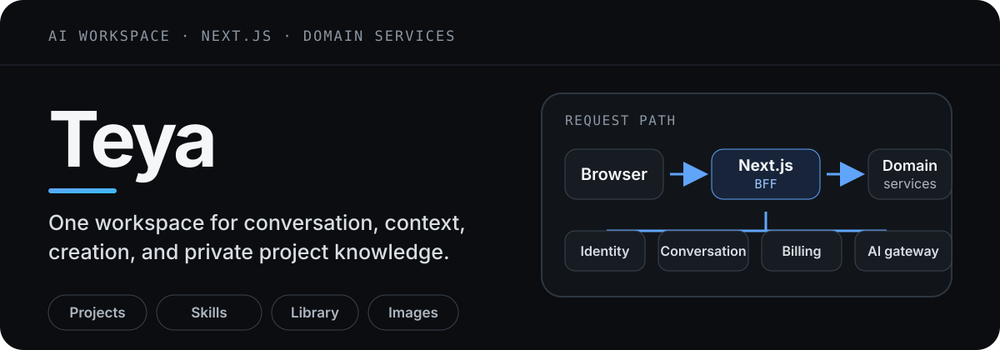
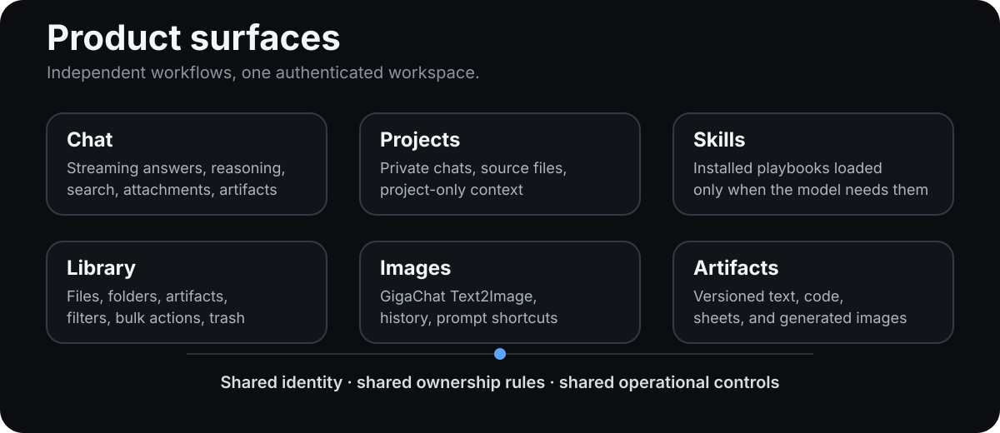
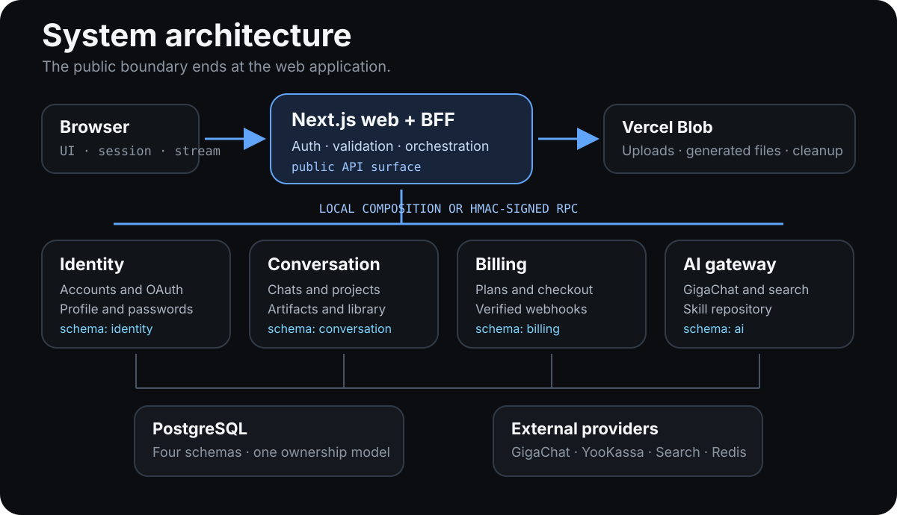
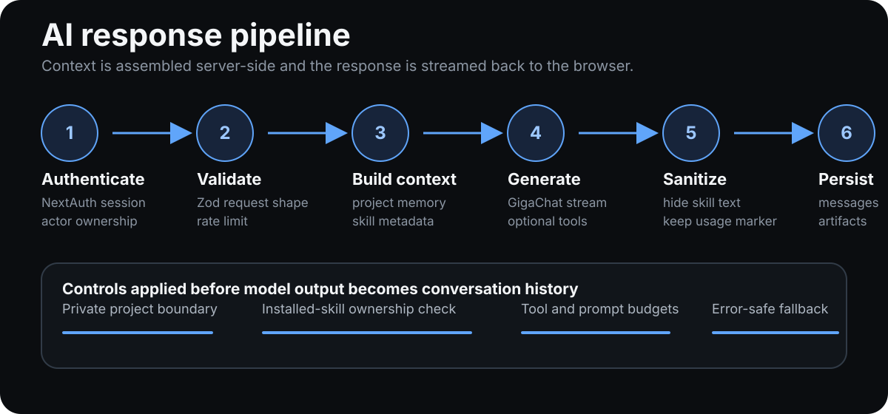
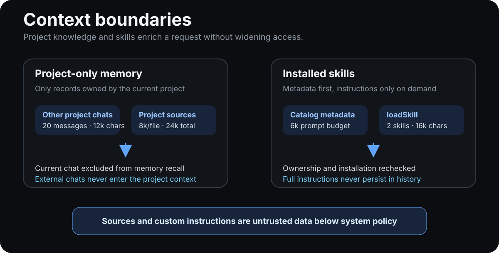
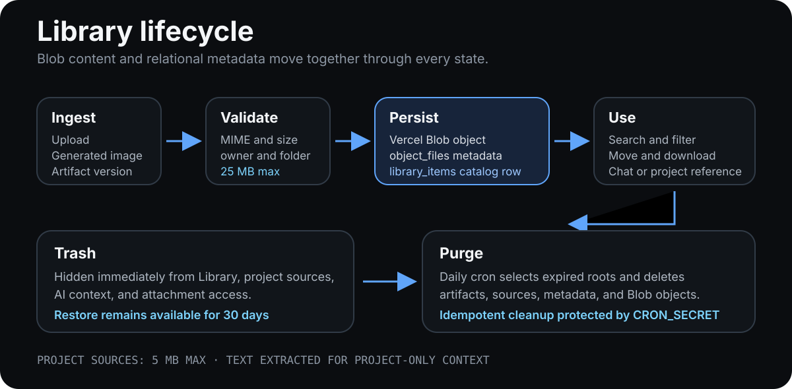
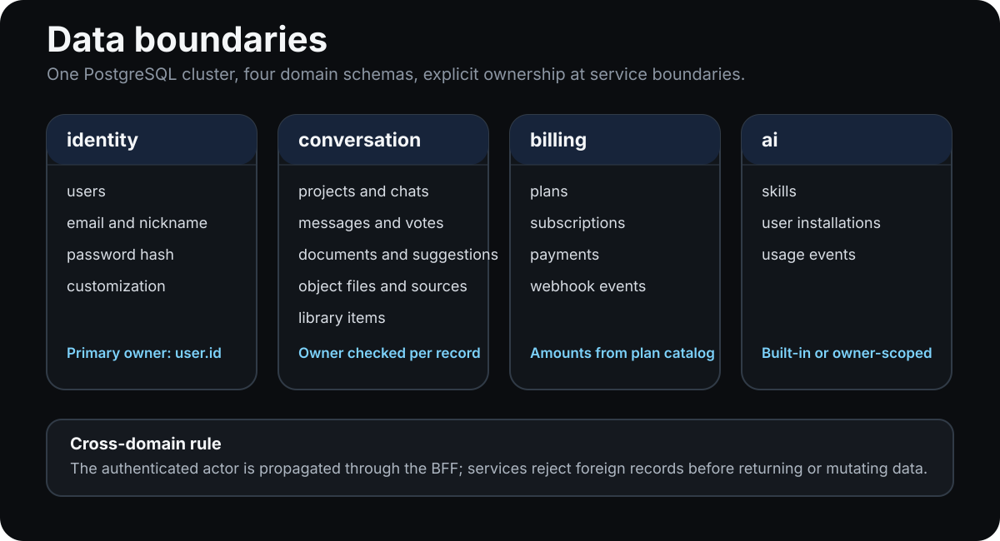
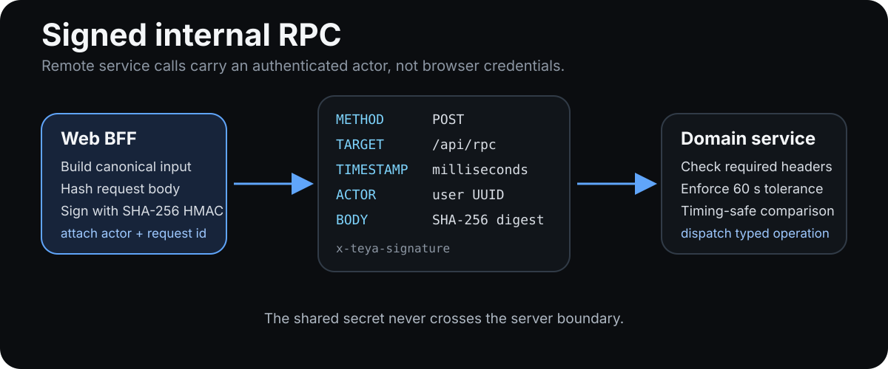
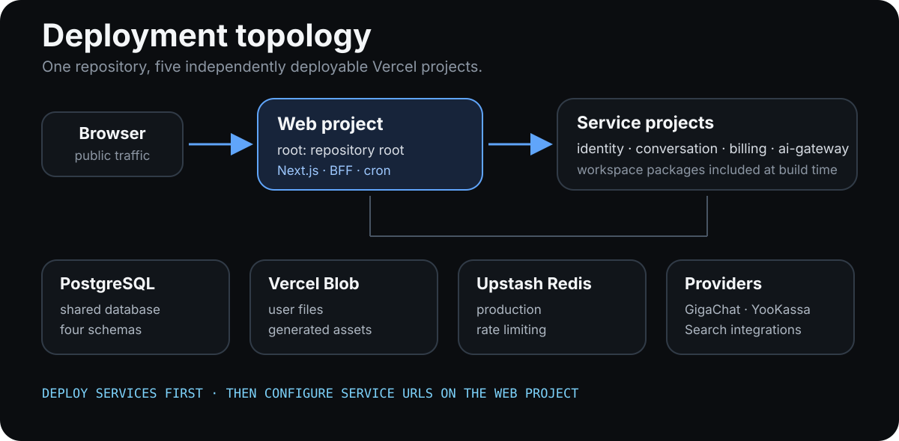

<p align="center">
  
</p>

This application has moved to `apps/web` in the Ori repository. Its internal pnpm workspace (`packages/` and `services/`) stays together for this source migration. From the repository root:

```bash
cd apps/web
pnpm install --frozen-lockfile
pnpm check
pnpm workspace:check
pnpm db:check
pnpm build
pnpm dev
```

The application root redirects to `/chat`; unauthenticated users continue through `/login` to the existing Ori website login. Ori's main website remains in `landing/`. Lumia's landing route, components and image are preserved separately at `docs/design/lumia-landing` in the repository root and are not part of this app. Shared history and the common model gateway are subsequent stages of the unification plan.

Web authentication uses the existing Ori email-code, Google and Yandex login, a one-time PKCE code, and the same account ID as the native apps. Configure `BLOT_WEB_APP_URL` on the account service and `AUTH_URL`, `AUTH_SECRET`, `BLOT_AUTH_URL` on the web app. See [deployment and verification](../../docs/status/web-blot-auth.md). Local development runs the website on port 3000 (`cd landing && npm run dev:local`) and this app on port 3001; copy `.env.example` to `.env.local` and configure real local service/database values. Use `127.0.0.1` consistently for both origins.

The shared PostgreSQL release uses `POSTGRES_URL` or `DATABASE_URL`, additive migrations with a separate journal, PostgreSQL rate limits and the existing server-side `BLOT_GIGACHAT_*` credentials. `pnpm build:cloud` migrates, verifies an isolated test chat and a short real model response, cleans up its test records, then builds. See [release configuration and limits](../../docs/status/web-postgres-release.md) before deploying either application.

Teya is the upstream full-stack AI workspace built around persistent conversations, private project context, installable instruction skills, generated artifacts, image workflows, and a unified file library.

The product is delivered as a Next.js application backed by four domain services. The web application is the only public application boundary. It authenticates the user, validates requests, applies rate limits, and calls the services either in-process for local development or through signed HTTP RPC in a distributed deployment.

## Contents

- [Product overview](#product-overview)
- [Architecture](#architecture)
- [AI response pipeline](#ai-response-pipeline)
- [Projects and skills](#projects-and-skills)
- [Library and file lifecycle](#library-and-file-lifecycle)
- [Data model](#data-model)
- [Security model](#security-model)
- [Repository structure](#repository-structure)
- [Local development](#local-development)
- [Environment configuration](#environment-configuration)
- [API surface](#api-surface)
- [Deployment](#deployment)
- [Verification](#verification)
- [Operational notes](#operational-notes)

## Product overview

<p align="center">
  
</p>

Teya groups related AI work into six surfaces:

| Surface | Purpose | Main capabilities |
| --- | --- | --- |
| Chat | General AI conversation | Streaming responses, standard and reasoning models, attachments, web search, generated artifacts, votes, editable messages |
| Projects | Isolated workspaces | Project-owned chats, uploaded sources, project-only memory, search, rename and delete |
| Skills | Reusable instruction playbooks | Built-in catalog, personal skills, install and uninstall, metadata-based selection, on-demand instruction loading |
| Library | Unified material catalog | Uploaded files, generated content, artifacts, folders, search, filters, sorting, bulk actions, downloads, trash and restore |
| Images | Focused image workflow | GigaChat Text2Image prompts, prompt presets, generated image history and chat handoff |
| Artifacts | Structured AI output | Versioned text, code, sheets and images with dedicated renderers and editing flows |

### What is implemented

| Area | Current implementation |
| --- | --- |
| Authentication | Shared Ori login, PKCE handoff, protected routes, remote session validation and logout |
| Models | GigaChat chat, reasoning and Text2Image adapters |
| Conversation history | Private and public chat metadata, messages, votes, documents and suggestions |
| Project memory | Other project chats and project sources, bounded and isolated from ordinary chats |
| Skills | Twelve seeded built-in skills plus owner-scoped custom skills |
| Search | Server-side search gateway with provider-specific credentials |
| Files | Vercel Blob storage, PostgreSQL metadata, thumbnails, single download and ZIP manifests |
| Billing | Server-owned plans, YooKassa checkout, verified provider state and idempotent webhook handling |
| Operations | Structured migrations, health endpoints, rate limiting, CI and a daily Library purge cron |

### Product principles

| Principle | Effect in the implementation |
| --- | --- |
| Server-owned trust | Authentication, model keys, payment amounts and provider credentials never come from the browser |
| Explicit ownership | Services receive an actor identifier and check every owner-scoped record |
| Bounded context | Project memory, skill metadata and loaded instructions have separate character and count budgets |
| Reversible deletion | Library items enter a 30-day trash state before physical cleanup |
| Local-first service composition | Empty service URLs use the same service classes in the Next.js process |
| Deployable boundaries | The same interfaces switch to signed HTTP RPC when service URLs are configured |

## Architecture

<p align="center">
  
</p>

### Request boundary

The browser talks only to the Next.js application. It does not call Identity, Conversation, Billing, or AI Gateway directly.

The web layer is responsible for:

1. Resolving the NextAuth session.
2. Mapping the session to a user actor ID.
3. Parsing external input with Zod.
4. Applying request-specific limits.
5. Coordinating one or more domain gateways.
6. Returning JSON, a file response, or an AI data stream.

Each gateway has two implementations:

| Mode | Selection | Behavior |
| --- | --- | --- |
| Local composition | Corresponding service URL is empty | Instantiates the service and PostgreSQL repository inside the web process |
| Remote service | Service URL and `INTERNAL_SERVICE_SECRET` are present | Calls the service endpoint with an HMAC-signed request |

This keeps local development compact without replacing domain boundaries with mocks. The same controller, service, repository and validation rules are used in both modes.

### Service responsibilities

| Component | Public responsibility | Owns | External dependencies |
| --- | --- | --- | --- |
| Web and BFF | Pages, authentication session, public APIs, orchestration, streaming | Browser contract and session boundary | All domain gateways, Vercel Blob |
| Identity | Legacy Lumia service retained for compatibility; web account identity comes from Ori, preferences from `identity.blot_profiles` | `identity` schema | PostgreSQL |
| Conversation | Chats, messages, projects, documents, votes, suggestions and Library metadata | `conversation` schema | PostgreSQL |
| Billing | Plan lookup, checkout, subscription state, webhook verification | `billing` schema | PostgreSQL, YooKassa |
| AI Gateway | Model proxy, reasoning, images, search and skill repository | `ai` schema | PostgreSQL, GigaChat, search providers |
| Platform package | Internal signatures and rate limiting | Shared server infrastructure | HMAC SHA-256, Upstash Redis |
| Contracts package | Runtime schemas and shared TypeScript types | Service protocol | Zod |
| Database package | Drizzle schema and migrations | Relational structure | PostgreSQL |

### Technology stack

| Layer | Technology |
| --- | --- |
| Application | Next.js 15, React 18, TypeScript |
| Styling and UI | Tailwind CSS, Radix UI, Framer Motion, Lucide and Hugeicons |
| AI streaming | Vercel AI SDK |
| Model provider | GigaChat chat, reasoning and Text2Image |
| Persistence | PostgreSQL with Drizzle ORM |
| Object storage | Vercel Blob |
| Authentication | Ori account service; NextAuth 5 encrypted web session |
| Validation | Zod |
| Billing | YooKassa |
| Rate limiting | Upstash Redis in production, in-memory store in development |
| Testing | Node test runner, Playwright |
| Code quality | Biome, TypeScript |
| Package management | pnpm workspace |

## AI response pipeline

<p align="center">
  
</p>

The main chat endpoint accepts a chat ID, an optional project ID, up to 200 messages and one of two configured model modes. The server then performs the following sequence:

| Stage | Operation | Failure behavior |
| --- | --- | --- |
| Authenticate | Resolve session and user ID | Return `401` |
| Validate | Parse the request, enforce message limits and consume the chat rate limit | Return `400` or `429` |
| Resolve chat | Confirm ownership and project association, or create a titled chat | Reject project mismatch |
| Build context | Load customization, project memory and installed skill summaries | Skills fail open; the base chat remains usable |
| Generate | Stream through the configured provider with allowed tools | Provider error becomes a controlled stream failure |
| Sanitize | Remove loaded instruction bodies and preserve only skill identity | Hidden skill text never reaches stored history |
| Persist | Store user and assistant messages and any generated artifacts | Conversation service enforces ownership again |

### Model modes

| Mode | Intended behavior | Tool access |
| --- | --- | --- |
| `chat-model` | General streaming conversation | Existing chat tools plus `loadSkill` when skills are installed |
| `chat-model-reasoning` | Reasoning-oriented response path | Reasoning-compatible tools, including `loadSkill` |

The model provider is selected behind the AI Gateway adapter. Provider-specific authentication and TLS handling remain in the service that owns them.

### Rate limiting

The chat endpoint uses a namespaced limiter:

| Setting | Value |
| --- | ---: |
| Requests | 80 |
| Window | 10,800 seconds |
| Development store | In-memory |
| Production store | Upstash Redis |

Production startup rejects a missing Redis configuration rather than silently falling back to per-instance memory.

## Projects and skills

<p align="center">
  
</p>

### Project-only memory

Every project is owner-scoped and currently uses the fixed `project_only` memory mode. A project chat is always private and cannot be published.

For a project request, the Conversation service builds context from:

| Input | Limit | Rule |
| --- | ---: | --- |
| Messages from other chats in the project | 20 recent messages | Current chat is excluded |
| Message text budget | 12,000 characters | Applied across selected messages |
| Individual source file | 8,000 characters | Extracted text only |
| Combined source budget | 24,000 characters | Applied across active project sources |

Source contents and recalled messages are placed below system instructions and explicitly labeled as untrusted data. A deleted Library source is removed from project context immediately even while its Blob object remains recoverable in trash.

### Project source ingestion

Project source uploads are intentionally stricter than general Library uploads:

| Constraint | Value |
| --- | --- |
| Maximum file size | 5 MB |
| Maximum sources per project | 20 |
| Stored extracted text | Up to 200,000 characters |
| Supported text families | TXT, Markdown, CSV, JSON and common source files |
| PDF handling | Synchronous extraction with `pdf-parse` |

The upload is written to Blob first. If validation, extraction, ownership checks or relational persistence fail, the newly uploaded Blob is removed.

### Skills

Skills are instruction documents, not executable plugins. Installing a skill grants no network access, credentials, browser capability or new server tool.

Teya ships with a seeded catalog grouped into:

| Category | Built-in skills |
| --- | --- |
| Featured | Writing Coach, Researcher, Data Analyst, Brainstormer |
| Productivity | Project Planner, Meeting Notes, Study Tutor |
| Creativity | Copywriter, Product Designer |
| Developer Tools | Code Reviewer, Debugger, SQL Expert |

Custom skills contain:

| Field | Limit |
| --- | ---: |
| Name | 80 characters |
| Description | 240 characters |
| When to use | 500 characters |
| Instructions | 8,000 characters |
| Personal skills per user | 20 |
| Installed skills per user | 24 |

### Skill loading protocol

1. Before generation, the web application fetches only installed skill summaries.
2. Name, description and `When to use` metadata enter a 6,000-character catalog block.
3. If the catalog is empty, the prompt and tool list remain unchanged.
4. The model may call `loadSkill(skillId)` when a skill matches the request.
5. The service rechecks both ownership and installation.
6. At most two distinct skills and 16,000 instruction characters are loaded for one response.
7. The UI receives a compact `Used skill: {name}` marker.
8. Full skill instructions are stripped from the stored and replayed message history.

Built-in skills cannot be modified or deleted. Personal skills are private to their owner and are installed automatically when created.

## Library and file lifecycle

<p align="center">
  
</p>

Library is the unified catalog for:

- ordinary and project chat attachments;
- project source files;
- generated Teya images;
- text, code, sheet and image artifacts;
- files uploaded directly from Library;
- nested folders created by the user.

### Catalog behavior

| Capability | Implementation |
| --- | --- |
| Search | Global name search with parent path |
| Views | List and grid, persisted in local storage |
| Tabs | All, Images and Documents |
| Filters | Uploaded, Generated, Images, Documents, Spreadsheets, Presentations, PDFs and Recently deleted |
| Sorting | Name, Modified and Size in both directions |
| Folders | Nested hierarchy with breadcrumbs and cycle protection |
| Selection | Current loaded result set, up to 20 bulk roots per operation |
| Downloads | Single file or recursively generated ZIP manifest |
| Trash | Root-aware recursive soft deletion |
| Restore | Restores the deleted root and eligible descendants |
| Purge | Daily cleanup after 30 days |

Folders are always returned before files. Renaming an uploaded file changes only the basename and preserves the original extension. Moving a Library item does not move its source chat or project association.

### Upload limits

General Library uploads support common images, PDFs, text, source files, Office documents, spreadsheets and presentations.

| Upload path | Maximum | Notes |
| --- | ---: | --- |
| Library upload | 25 MB per file | Direct client upload when Blob is configured |
| Chat attachment | 25 MB per file | Creates both `object_files` and `library_items` metadata |
| Project source | 5 MB per file | Text extraction required |
| Bulk download | 20 selected roots | Folders included recursively |
| ZIP content | 100 MB | Calculated before archive response |

### Deletion semantics

Moving an item to trash immediately:

- removes it from normal Library queries;
- removes a project source from source lists and AI context;
- turns old message attachments into a `File deleted` state;
- retains the Blob object and metadata for restoration.

Permanent deletion removes the relational item, linked project source, object metadata, artifact versions and Blob object. Folder deletion applies recursively. The purge operation is designed to be idempotent.

## Data model

<p align="center">
  
</p>

The database uses four PostgreSQL schemas:

### Identity schema

| Table | Purpose | Important constraints |
| --- | --- | --- |
| `identity.users` | Preserved legacy Lumia identities; not used to authenticate Ori web users | Unique email and nickname |
| `identity.blot_profiles` | Web display preferences for an existing Ori owner | Shared Ori owner ID; no automatic email linking |

### Conversation schema

| Table | Purpose | Important relationships |
| --- | --- | --- |
| `conversation.projects` | Project name and memory mode | Owner-scoped |
| `conversation.chats` | Chat title, visibility and optional project | Project deletion cascades to chats |
| `conversation.messages` | Structured message parts and attachments | Chat deletion cascades |
| `conversation.votes` | Per-message vote state | Composite key on chat and message |
| `conversation.documents` | Versioned artifact content | Composite key on document ID and creation time |
| `conversation.suggestions` | Proposed document changes | References a specific document version |
| `conversation.object_files` | Blob pathname, URL, type and size | Owner-scoped object metadata |
| `conversation.project_sources` | Extracted project source text | Unique object file link |
| `conversation.library_items` | File, folder or artifact catalog record | Recursive parent, unique object or document link |

### Billing schema

| Table | Purpose | Important constraints |
| --- | --- | --- |
| `billing.plans` | Server-owned price catalog | Currency and active state stored server-side |
| `billing.subscriptions` | Current user plan | One row per user |
| `billing.payments` | Local and provider payment state | Unique idempotency and provider IDs |
| `billing.webhook_events` | Processed provider state transitions | Unique event key |

### AI schema

| Table | Purpose | Important constraints |
| --- | --- | --- |
| `ai.skills` | Built-in and custom skill definitions | Built-ins have no owner; custom rows are owner-scoped |
| `ai.user_skill_installations` | User-to-skill installation mapping | Composite primary key |
| `ai.usage_events` | Idempotent feature usage record | Unique request ID |

### Migration sequence

| Migration | Responsibility |
| --- | --- |
| `0000_clean_foundation.sql` | Identity, conversation, billing and AI foundation |
| `0001_projects.sql` | Projects, project sources and project chat association |
| `0002_skills.sql` | Skill catalog and installations |
| `0003_library.sql` | Unified Library metadata, backfill and deletion lifecycle |

The current migration foundation is intended for a fresh database. It does not migrate the historical pre-workspace schema.

## Security model

### Internal service authentication

<p align="center">
  
</p>

Remote gateways sign a canonical request containing:

```text
HTTP method
path and query
timestamp
actor ID
SHA-256 body digest
```

The signature uses HMAC SHA-256 and the shared `INTERNAL_SERVICE_SECRET`. Each request also carries a generated request ID. The receiving service:

1. requires every internal authentication header;
2. rejects timestamps outside a 60-second tolerance;
3. rebuilds the canonical payload;
4. compares signatures with a timing-safe operation;
5. dispatches the validated, typed RPC operation.

### Security invariants

| Boundary | Invariant |
| --- | --- |
| Session | Protected pages require an authenticated NextAuth session |
| Ownership | Foreign user IDs cannot read or mutate owner-scoped records |
| Projects | Project chats remain private and cannot cross project boundaries |
| Skills | Only installed skills can be loaded; built-ins remain immutable |
| Prompt data | Project files and personal skill instructions are treated as untrusted data |
| Skill history | Full loaded instructions are removed before message persistence |
| Payments | Amount, currency and plan are resolved from the server plan catalog |
| Webhooks | Provider state is fetched and checked against local payment metadata |
| Files | Failed uploads remove partially written Blob objects |
| Trash | Deleted items become unavailable before physical deletion |
| Account deletion | Identity, conversation, billing and skill data are cleaned through domain services |
| Secrets | Provider keys remain in the service that owns the integration |

### Payment verification

YooKassa webhook content is treated as a notification, not as trusted payment state. Billing fetches the payment from YooKassa and checks:

- local payment identifier;
- provider payment identifier;
- user identifier;
- plan;
- amount;
- currency;
- provider status;
- paid state;
- event idempotency.

A subscription is activated only after those values agree with the server-owned local payment record.

## Repository structure

```text
.
├── app
│   ├── (auth)                 Authentication routes and NextAuth setup
│   ├── (chat)                 Authenticated pages and BFF APIs
│   ├── api                    Account, billing, webhook and cron routes
│   └── page.tsx               Application entry redirect to /chat
├── artifacts
│   ├── code                   Code artifact client and server
│   ├── image                  Image artifact client and server
│   ├── sheet                  Sheet artifact client and server
│   └── text                   Text artifact client and server
├── assets
│   └── readme                 GitHub-safe documentation SVGs
├── components
│   ├── images                 Images workspace
│   ├── library                Library catalog
│   ├── projects               Project list and detail flows
│   ├── skills                 Skill catalog and editor
│   └── ui                     Shared UI primitives
├── lib
│   ├── ai                     Prompts, models, tools and skill handling
│   ├── library                Upload and download policies
│   ├── projects               Project source extraction and API helpers
│   └── services               Local and remote domain gateways
├── packages
│   ├── contracts              Shared Zod schemas and TypeScript types
│   ├── database               Drizzle schema and PostgreSQL migrations
│   └── platform               HMAC RPC and rate limiting
├── services
│   ├── ai-gateway             Models, search and skill repository
│   ├── billing                Plans, payments and subscriptions
│   ├── conversation           Chats, projects, artifacts and Library
│   └── identity               Accounts and profile data
└── tests
    ├── unit                   Service and policy tests
    └── *.test.ts              Playwright end-to-end scenarios
```

Each service follows the same direction:

```text
API handler → controller → service → repository → PostgreSQL
```

Controllers parse signed RPC operations and map domain errors to HTTP responses. Services own business rules. Repositories own persistence. The web application depends on gateway interfaces rather than service internals.

## Local development

### Requirements

| Requirement | Version or purpose |
| --- | --- |
| Node.js | 22 or newer |
| pnpm | 11 |
| PostgreSQL | Application data |
| Vercel Blob token | File upload and persistent generated files |
| GigaChat credentials | Chat, reasoning and image generation |

### Setup

```bash
pnpm install
cp .env.example .env.local
pnpm db:migrate
pnpm dev
```

Open [http://localhost:3000](http://localhost:3000).

When `IDENTITY_SERVICE_URL`, `CONVERSATION_SERVICE_URL`, `BILLING_SERVICE_URL` and `AI_GATEWAY_URL` are empty, all four services are composed locally in the Next.js process.

### Useful commands

| Command | Purpose |
| --- | --- |
| `pnpm dev` | Start the Turbopack development server |
| `pnpm build` | Create the production Next.js build |
| `pnpm start` | Run the production build |
| `pnpm lint` | Run Biome checks |
| `pnpm lint:fix` | Apply safe Biome fixes |
| `pnpm typecheck` | Run TypeScript without emitting files |
| `pnpm test:unit` | Run Node unit tests |
| `pnpm test:e2e` | Run Playwright tests |
| `pnpm check` | Run lint, typecheck and unit tests |
| `pnpm workspace:check` | Run package-level checks across the workspace |
| `pnpm db:migrate` | Apply PostgreSQL migrations |
| `pnpm db:generate` | Generate a Drizzle migration |
| `pnpm db:studio` | Open Drizzle Studio |

## Environment configuration

Start from `.env.example`. Replace every placeholder before using the related integration.

### Core web configuration

| Variable | Required | Used by |
| --- | --- | --- |
| `POSTGRES_URL` | Yes for local composition | Web process and local service repositories |
| `AUTH_SECRET` | Yes, at least 32 random characters | Encrypted NextAuth session and login attempt |
| `AUTH_URL` | Yes | Authentication callback origin |
| `BLOT_AUTH_URL` | Yes in production | Existing Ori website `/login` URL |
| `BLOT_ACCOUNT_SERVICE_URL` | Optional | Account API origin; defaults to the website origin |
| `INTERNAL_SERVICE_SECRET` | Yes for remote services | Web and all four services |
| `BLOB_READ_WRITE_TOKEN` | For persistent files | Web upload, download cleanup and Library purge |
| `CRON_SECRET` | For scheduled purge | Web cron endpoint |

### Service routing

| Variable | Empty value | Configured value |
| --- | --- | --- |
| `IDENTITY_SERVICE_URL` | Legacy Identity service only | Not used for web sign-in; Ori owns authentication |
| `CONVERSATION_SERVICE_URL` | Local Conversation composition | Remote Conversation RPC |
| `BILLING_SERVICE_URL` | Local Billing composition | Remote Billing RPC |
| `AI_GATEWAY_URL` | Local AI Gateway composition | Remote AI, search and skill calls |

### Billing

| Variable | Purpose |
| --- | --- |
| `YOOKASSA_SHOP_ID` | YooKassa shop identifier |
| `YOOKASSA_SECRET_KEY` | YooKassa server credential |
| `YOOKASSA_VAT_CODE` | Receipt VAT code |

### AI and search

| Variable | Purpose |
| --- | --- |
| `GIGACHAT_AUTH_KEY` | GigaChat OAuth authorization value |
| `GIGACHAT_SCOPE` | GigaChat API scope |
| `GIGACHAT_MODEL` | Default GigaChat model identifier |
| `SERPER_API_KEY` | Web search provider |
| `UNSPLASH_ACCESS_KEY` | Image search provider |
| `YOUTUBE_API_KEY` | Video search provider |

### Production rate limiting

| Variable | Purpose |
| --- | --- |
| `UPSTASH_REDIS_REST_URL` | Upstash REST endpoint |
| `UPSTASH_REDIS_REST_TOKEN` | Upstash REST credential |

## API surface

The browser-facing API is implemented in the Next.js application. The list below groups related routes rather than documenting internal implementation types.

### Conversation and artifacts

| Method | Route | Purpose |
| --- | --- | --- |
| `POST` | `/api/chat` | Create or continue a streamed chat response |
| `DELETE` | `/api/chat?id={chatId}` | Delete a chat |
| `GET` | `/api/history` | List recent chats |
| `GET`, `POST`, `PATCH`, `DELETE` | `/api/document` | Read and mutate artifact versions |
| `GET`, `POST` | `/api/suggestions` | Read or save artifact suggestions |
| `PATCH` | `/api/vote` | Update message feedback |
| `POST` | `/api/files/upload` | Upload an authenticated chat attachment |

### Projects

| Method | Route | Purpose |
| --- | --- | --- |
| `GET`, `POST` | `/api/projects` | Search or create projects |
| `GET`, `PATCH`, `DELETE` | `/api/projects/{id}` | Read, rename or delete a project |
| `GET`, `POST` | `/api/projects/{id}/sources` | List or upload project sources |
| `DELETE` | `/api/projects/{id}/sources/{sourceId}` | Delete a source |

### Skills

| Method | Route | Purpose |
| --- | --- | --- |
| `GET`, `POST` | `/api/skills` | Search catalog or create a personal skill |
| `GET`, `PATCH`, `DELETE` | `/api/skills/{id}` | Read or manage a skill |
| `PUT`, `DELETE` | `/api/skills/{id}/installation` | Install or uninstall a skill |

### Library

| Method | Route | Purpose |
| --- | --- | --- |
| `GET` | `/api/library/items` | List, search, filter, sort and paginate |
| `POST` | `/api/library/folders` | Create a folder |
| `PATCH`, `DELETE` | `/api/library/items/{id}` | Rename, move or trash an item |
| `POST` | `/api/library/items/{id}/restore` | Restore a deleted root |
| `DELETE` | `/api/library/items/{id}/permanent` | Permanently delete an item |
| `POST` | `/api/library/items/bulk` | Move, trash, restore or purge multiple roots |
| `GET` | `/api/library/items/{id}/download` | Download a file or folder archive |
| `GET` | `/api/library/items/{id}/thumbnail` | Resolve an image thumbnail |
| `POST` | `/api/library/download` | Prepare a multi-root ZIP download |
| `POST` | `/api/library/upload` | Coordinate a direct Blob client upload |

### Identity and billing

| Method | Route | Purpose |
| --- | --- | --- |
| `GET`, `PATCH` | `/api/user-profile` | Read or update profile customization |
| `POST` | `/api/update-nickname` | Change nickname |
| `POST` | `/api/billing/checkout` | Create an idempotent YooKassa checkout |
| `GET` | `/api/billing/status` | Read payment status |
| `GET`, `DELETE` | `/api/billing/subscription` | Read or cancel subscription |
| `POST` | `/api/yookassa-webhook` | Receive YooKassa notifications |

### Internal services

| Service | Endpoints |
| --- | --- |
| Identity | `/api/health`, `/api/rpc` |
| Conversation | `/api/health`, `/api/rpc` |
| Billing | `/api/health`, `/api/rpc`, `/api/webhook`, `/api/composition` |
| AI Gateway | `/api/health`, `/api/chat/completions`, `/api/search`, `/api/skills` |

Internal endpoints use shared typed operation schemas from `packages/contracts`. They are not intended as browser APIs.

## Deployment

<p align="center">
  
</p>

Create five Vercel projects from the same repository:

| Vercel project | Root directory | Maximum function duration |
| --- | --- | ---: |
| Web | `apps/web` | Chat route: 300 seconds |
| Identity | `apps/web/services/identity` | 30 seconds |
| Conversation | `apps/web/services/conversation` | 60 seconds |
| Billing | `apps/web/services/billing` | 60 seconds |
| AI Gateway | `apps/web/services/ai-gateway` | 300 seconds |

For service projects, enable access to source files outside the selected root so Vercel can package `packages/contracts`, `packages/database` and `packages/platform`.

### Deployment order

1. Provision PostgreSQL, Vercel Blob and Upstash Redis.
2. Generate a strong shared `INTERNAL_SERVICE_SECRET`.
3. Deploy Identity, Conversation, Billing and AI Gateway.
4. Configure the four service URLs on the web project.
5. Deploy the web project.
6. Register the YooKassa webhook.
7. Confirm service health and run an authenticated chat.
8. Confirm the daily Library purge cron can authenticate.

Configure the web project with:

```env
IDENTITY_SERVICE_URL=https://identity.example.com
CONVERSATION_SERVICE_URL=https://conversation.example.com
BILLING_SERVICE_URL=https://billing.example.com
AI_GATEWAY_URL=https://ai.example.com
```

Use the same `INTERNAL_SERVICE_SECRET` on the web project and all domain service projects.

Register this billing webhook URL:

```text
https://billing.example.com/api/webhook
```

The root `vercel.json` schedules Library cleanup every day at `03:00`:

```text
GET /api/internal/library/purge
```

Vercel sends `CRON_SECRET` as a bearer token. The route rejects missing or invalid authorization.

### Environment ownership

| Variable | Web | Identity | Conversation | Billing | AI Gateway |
| --- | --- | --- | --- | --- | --- |
| `POSTGRES_URL` | Local composition | Required | Required | Required | Required |
| `AUTH_SECRET`, `AUTH_URL` | Required | No | No | No | No |
| `BLOT_AUTH_URL`, `BLOT_ACCOUNT_SERVICE_URL` | Shared Ori login/API | No | No | No | No |
| `INTERNAL_SERVICE_SECRET` | Required | Required | Required | Required | Required |
| Service URLs | Required for remote mode | No | No | No | No |
| YooKassa credentials | Local composition | No | No | Required | No |
| GigaChat credentials | Local composition | No | No | No | Required |
| Search provider credentials | Local composition | No | No | No | Required |
| Upstash Redis credentials | Required in production | No | No | No | Required |
| `BLOB_READ_WRITE_TOKEN` | Required for files | No | No | No | No |
| `CRON_SECRET` | Required for purge | No | No | No | No |

## Verification

### Standard check sequence

```bash
pnpm lint
pnpm typecheck
pnpm test:unit
pnpm workspace:check
pnpm build
```

### Test coverage by boundary

| Area | Examples covered in the repository |
| --- | --- |
| Internal RPC | Signature construction, verification and rejected invalid requests |
| Identity | Registration, authentication, ownership and account operations |
| Conversation | Controller validation, private chat access and persistence |
| Projects | Ownership, cross-user rejection, source extraction and context budgets |
| Skills | Catalog rules, immutable built-ins, installation and `loadSkill` limits |
| Library | Folder cycles, filtering, deletion, restoration and cleanup |
| Billing | Catalog-controlled amounts, provider verification and webhook idempotency |
| AI Gateway | Model selection, GigaChat adapter behavior and image generation responses |
| End-to-end | Chat, reasoning, projects, skills, Library, images and artifacts |

### Focused Playwright runs

```bash
pnpm exec playwright test tests/projects.test.ts
pnpm exec playwright test tests/skills.test.ts
pnpm exec playwright test tests/library.test.ts
pnpm exec playwright test tests/images.test.ts
```

Playwright uses the `PLAYWRIGHT=True` environment flag through `pnpm test:e2e`.

## Operational notes

### Vercel Blob reports that no token was found

Set `BLOB_READ_WRITE_TOKEN` in `.env.local` for local development or in the web Vercel project. Restart the development server after adding it.

Without the token:

- direct Library upload returns `503`;
- server uploads cannot persist files;
- Blob cleanup cannot run;
- text-only chat paths remain available.

### Database migration warning

The clean foundation is designed for a new database. Pointing it at a historical schema is not an automatic upgrade path.

For a new local database:

```bash
pnpm db:migrate
```

### Service URL mismatch

All four service URLs should either be intentionally blank for local composition or point to deployed services that share the same `INTERNAL_SERVICE_SECRET`. Mixing a stale URL with local services can make one domain appear unavailable while the rest work.

### Production rate limiter

Production requires both:

```env
UPSTASH_REDIS_REST_URL=...
UPSTASH_REDIS_REST_TOKEN=...
```

The application intentionally refuses the development in-memory fallback in production.

### GigaChat TLS

The AI Gateway loads the official Russian Trusted Root CA at the application level and keeps normal TLS verification enabled. Do not disable certificate verification as a workaround.

### Library cleanup

The database purge is completed before Blob cleanup. If Blob deletion fails, the endpoint returns an error so operations can investigate orphaned storage. The relational purge itself remains idempotent.

## Scope and current limits

The current implementation intentionally excludes:

- shared projects and shared personal skills;
- public skill publishing;
- Slack, Figma, GitHub and other third-party plugin actions;
- moving an existing ordinary chat into a project;
- live editing of uploaded Office or PDF content;
- public Library links;
- drag-and-drop folder movement;
- executable user-defined tools.

These boundaries keep project memory private, skills instruction-only and file ownership unambiguous.

## Contribution workflow

Before opening a change:

1. Keep public inputs represented by shared Zod contracts.
2. Put business rules in the relevant service rather than in a route handler.
3. Enforce owner checks in the service even when the BFF already authenticated the user.
4. Add a migration for relational changes.
5. Add or update unit tests for domain rules.
6. Add focused Playwright coverage for visible workflows.
7. Run the standard verification sequence.

## License

Teya is distributed under the terms in [LICENSE](LICENSE).
