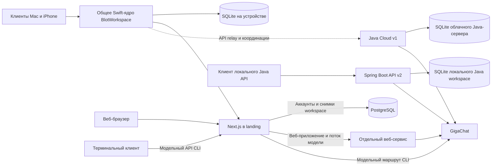
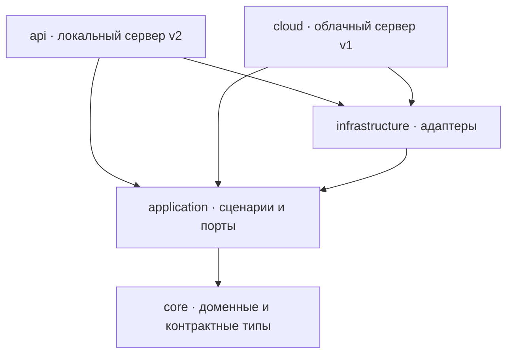
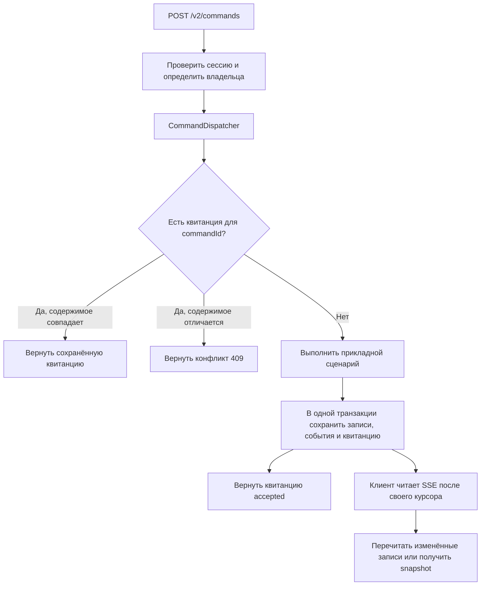
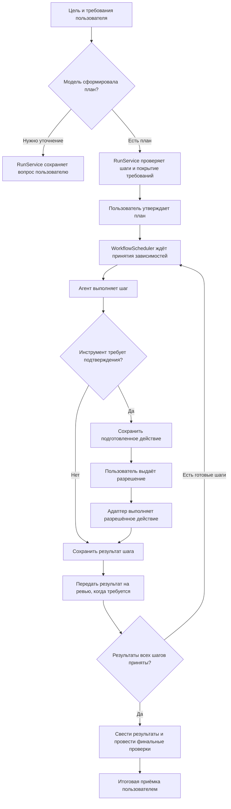
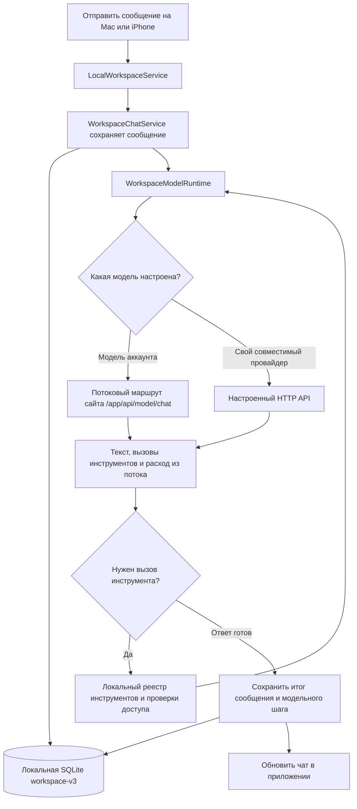
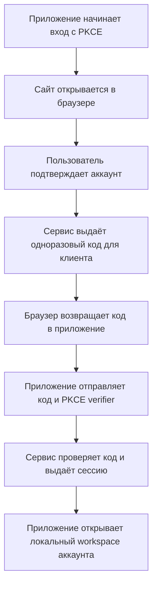

# Как работает Blot

По блок-схемам можно проследить, куда уходит запрос пользователя, где выполняется работа и какие данные сохраняются. Разбор каждого файла доступен в [оглавлении бэкенда](../README.md#бэкенд-по-файлам).

Документация описывает код ветки `mac/workspace` на ревизии [`4e6c47f`](https://github.com/Hqzdev/kiln-agent/tree/4e6c47f65e0e734dedc122d586c7bb67d37395a3). Ссылки на исходники, которые отличаются от `mac/main`, ведут на эту ревизию.

## Карта системы

Локальные данные Swift и Java v2 хранятся в разных базах. Java Cloud и веб-сервис аккаунтов также используют разные хранилища. При наличии URL PostgreSQL маршруты авторизации сайта работают через `landing/lib/accounts`. В штатной серверной ветке без этого URL `accountRequest` перенаправляет поддерживаемые вызовы в Java Cloud. Связь Swift с Java Cloud на схеме обозначает интерфейсы репликации и координации, доступные в коде.

См. [запуск Apple workspace](https://github.com/Hqzdev/kiln-agent/blob/4e6c47f65e0e734dedc122d586c7bb67d37395a3/apps/shared/WorkspaceV3/WorkspaceRootView.swift), [выбор сервиса аккаунтов](https://github.com/Hqzdev/kiln-agent/blob/4e6c47f65e0e734dedc122d586c7bb67d37395a3/landing/lib/auth/config.mjs), [прокси веб-приложения](https://github.com/Hqzdev/kiln-agent/blob/4e6c47f65e0e734dedc122d586c7bb67d37395a3/landing/proxy.js), [модель аккаунта Apple](https://github.com/Hqzdev/kiln-agent/blob/4e6c47f65e0e734dedc122d586c7bb67d37395a3/packages/BlotWorkspace/Sources/BlotWorkspace/ChatModel.swift), [маршрут CLI](https://github.com/Hqzdev/kiln-agent/blob/4e6c47f65e0e734dedc122d586c7bb67d37395a3/landing/app/v1/cli/model/route.js) и [базу Java Cloud](../cloud/src/main/java/dev/blot/cloud/storage/CloudDatabase.java.md).

## Зависимости Java-модулей

Стрелки показывают зависимости при сборке. `api` и `cloud` собираются в отдельные JAR.

См. [api](../api/README.md), [application](../application/README.md), [infrastructure](../infrastructure/README.md), [core](../core/README.md) и [cloud](../cloud/README.md). Формат v3 задаётся [`contracts/v3/model.json`](https://github.com/Hqzdev/kiln-agent/blob/4e6c47f65e0e734dedc122d586c7bb67d37395a3/contracts/v3/model.json) и используется для генерации Java- и Swift-типов. Версия общего формата данных и префикс HTTP-маршрута относятся к разным частям системы.

## Локальная Java-команда и события v2

Для отправки сообщения сценарий сохраняет сообщение и добавляет запись генерации в очередь. Фоновый обработчик вызывает модель и пишет ход и результат в хранилище. Клиент наблюдает обновления через SSE. Квитанция `accepted` появляется в момент приёма команды. Итог генерации лежит в записях диалога и генерации.

См. [WorkspaceController](../api/src/main/java/dev/blot/api/workspace/controllers/WorkspaceController.java.md), [CommandDispatcher](../application/src/main/java/dev/blot/application/workspace/commands/CommandDispatcher.java.md), [ConversationService](../application/src/main/java/dev/blot/application/workspace/conversation/ConversationService.java.md), [GenerationWorker](../application/src/main/java/dev/blot/application/workspace/execution/GenerationWorker.java.md) и [EventController](../api/src/main/java/dev/blot/api/workspace/controllers/EventController.java.md).

## План, агент и подтверждение действия в Java v2

При неизвестном итоге внешней операции `ToolRecoveryService` сверяет сохранённое состояние операции. Подготовленные действия привязаны к параметрам и проверяются перед выполнением.

См. [RunService](../application/src/main/java/dev/blot/application/workspace/execution/RunService.java.md), [WorkflowScheduler](../application/src/main/java/dev/blot/application/workspace/execution/WorkflowScheduler.java.md), [PermissionService](../application/src/main/java/dev/blot/application/workspace/permissions/PermissionService.java.md), [PreparedActionExecutor](../application/src/main/java/dev/blot/application/workspace/execution/PreparedActionExecutor.java.md), [ToolRecoveryService](../application/src/main/java/dev/blot/application/workspace/execution/ToolRecoveryService.java.md) и [IntegrationService](../application/src/main/java/dev/blot/application/workspace/integrations/IntegrationService.java.md).

## Чат Apple и ответ модели

Swift-ядро записывает состояние сообщения и модельного шага. Модель аккаунта получает токен сессии и запрашивает поток через сайт. Доступные локальные инструменты зависят от конфигурации агента, прав и устройства.

См. [LocalWorkspaceService](https://github.com/Hqzdev/kiln-agent/blob/4e6c47f65e0e734dedc122d586c7bb67d37395a3/apps/shared/WorkspaceV3/LocalWorkspaceService.swift), [WorkspaceChatService](https://github.com/Hqzdev/kiln-agent/blob/4e6c47f65e0e734dedc122d586c7bb67d37395a3/packages/BlotWorkspace/Sources/BlotWorkspace/WorkspaceChatService.swift), [WorkspaceModelRuntime](https://github.com/Hqzdev/kiln-agent/blob/4e6c47f65e0e734dedc122d586c7bb67d37395a3/packages/BlotWorkspace/Sources/BlotWorkspace/WorkspaceModelRuntime.swift) и [модель аккаунта](https://github.com/Hqzdev/kiln-agent/blob/4e6c47f65e0e734dedc122d586c7bb67d37395a3/packages/BlotWorkspace/Sources/BlotWorkspace/ChatModel.swift).

## Вход в приложение Apple через сайт

Сервис проверяет соответствие кода исходному запросу. Приложение сохраняет сессию в хранилище учётных данных и открывает SQLite рабочего пространства по идентификаторам аккаунта и workspace.

См. [WorkspaceBrowserAuthorization](../../packages/BlotWorkspace/Sources/BlotWorkspace/WorkspaceBrowserAuthorization.swift), [WorkspaceCloudSession](../../packages/BlotWorkspace/Sources/BlotWorkspace/WorkspaceCloudSession.swift), [коды сайта](https://github.com/Hqzdev/kiln-agent/blob/4e6c47f65e0e734dedc122d586c7bb67d37395a3/landing/lib/accounts/browser-codes.mjs), [CloudBrowserAuthorization](../cloud/src/main/java/dev/blot/cloud/identity/CloudBrowserAuthorization.java.md) и [открытие workspace](https://github.com/Hqzdev/kiln-agent/blob/4e6c47f65e0e734dedc122d586c7bb67d37395a3/apps/shared/WorkspaceV3/WorkspaceAccountApplicationService.swift).

## Снимки аккаунта и зашифрованный relay

```mermaid
flowchart TD
    subgraph Account["Снимки аккаунта через веб-сервис"]
        Local1["SQLite первого Apple-устройства"] --> Backup["WorkspaceCloudBackup готовит снимок"]
        Backup --> Server["Маршрут /v1/workspace/backups принимает части"]
        Server --> PG[("PostgreSQL · снимки аккаунта")]
        PG --> Restore["Второе устройство скачивает части и сверяет хеш"]
        Restore --> Local2["Установить снимок в локальную SQLite"]
    end
    subgraph Relay["Транспорт изменений через Java Cloud"]
        Outbox["Исходящие изменения workspace"] --> Seal["Swift подписывает и шифрует пакеты"]
        Seal --> Transfer["CloudRelay сохраняет и отдаёт пакеты по курсору"]
        Transfer --> Open["Получатель проверяет подпись и расшифровывает"]
        Open --> Apply["Применить изменения и сохранить курсор"]
        Apply --> ACK["Отправить подтверждение relay"]
    end
```

Обычный запуск аккаунта Apple включает `WorkspaceCloudBackup`. Он загружает снимок частями и проверяет его целостность при скачивании. Для `CloudRelay` шифрование и расшифровка происходят на устройствах. В Swift также есть обмен напрямую между доверенными устройствами через `WorkspacePeerSync` и отдельный транспорт сопряжения находящихся рядом устройств.

См. [WorkspaceCloudBackup](https://github.com/Hqzdev/kiln-agent/blob/4e6c47f65e0e734dedc122d586c7bb67d37395a3/packages/BlotWorkspace/Sources/BlotWorkspace/WorkspaceCloudBackup.swift), [сервер снимков аккаунта](https://github.com/Hqzdev/kiln-agent/blob/4e6c47f65e0e734dedc122d586c7bb67d37395a3/landing/lib/accounts/workspace-backups.mjs), [WorkspaceSyncEngine](../../packages/BlotWorkspace/Sources/BlotWorkspace/WorkspaceSyncEngine.swift), [CloudRelay](../cloud/src/main/java/dev/blot/cloud/relay/CloudRelay.java.md), [WorkspacePeerSync](../../packages/BlotWorkspace/Sources/BlotWorkspace/WorkspacePeerSync.swift) и [транспорт сопряжения](../../apps/shared/WorkspaceV3/WorkspaceNearbyPairingTransport.swift).
