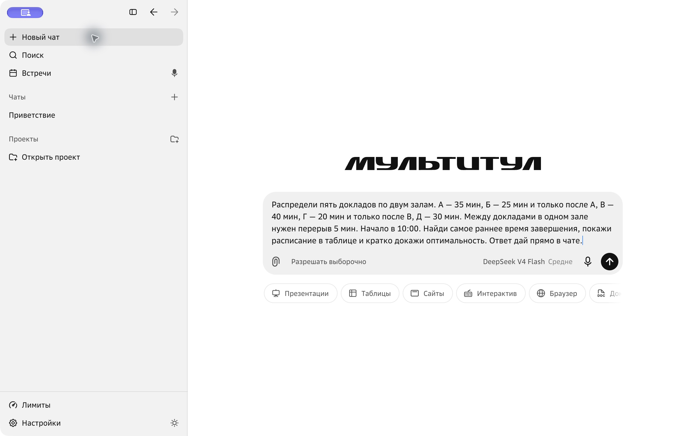
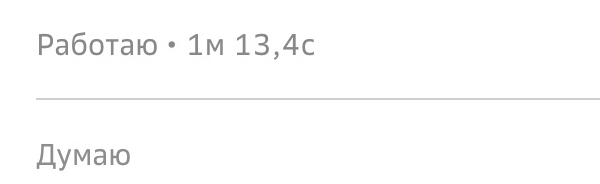
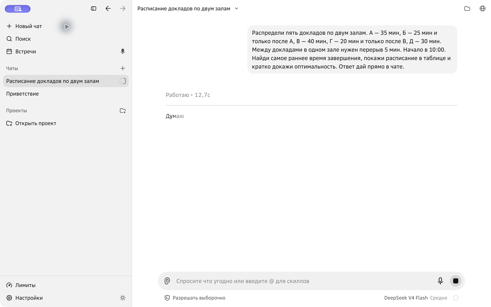
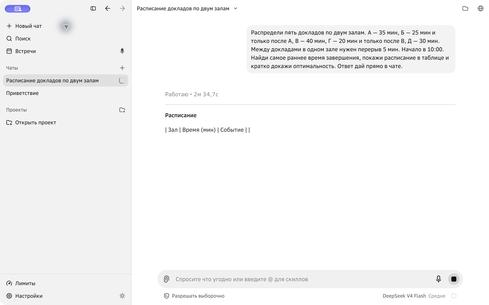
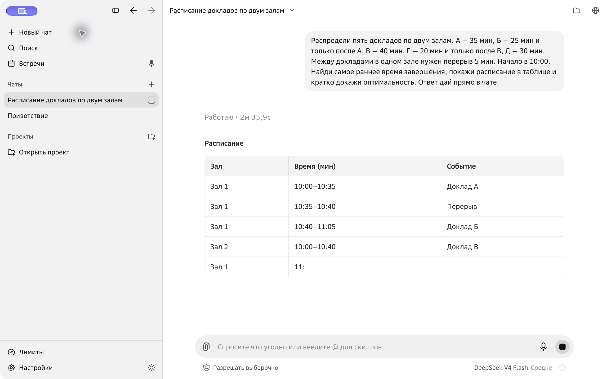
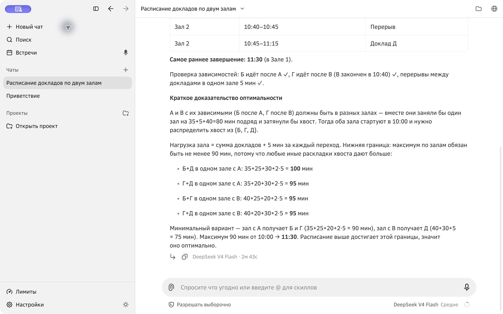
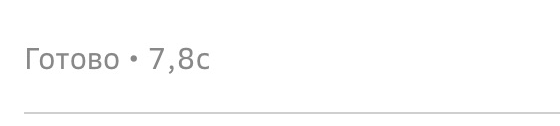

# Как MultiTool показывает ход ответа

**21 ноября 2026 · MultiTool 1.0.20261120 для macOS · светлая тема · DeepSeek V4 Flash · «Средне».** В отдельном чате «Расписание докладов по двум залам» модель получила задачу разместить пять докладов с зависимостями и перерывами, построить таблицу и обосновать время окончания. Полное время по индикатору приложения — **2м 43,2с**.

[Посмотреть последние 13 секунд выполнения, от «Думаю» до готового ответа](answer.mp4)

## 1. Отправка

Перед отправкой запрос находится в центральном поле нового чата. После отправки вопрос виден справа в светло-серой скруглённой плашке. Ответ начинается ниже, у левого края более широкой колонки. Поле ввода располагается у нижнего края окна. В правой части поля во время работы видна круглая кнопка с тёмным квадратом «Остановить».

## 2. Ожидание и движение букв

Над тонким горизонтальным разделителем серым текстом написано «Работаю • 12,7с». Ниже, с тем же левым отступом, стоит одно слово «Думаю». Оно сразу видно целиком. Положение букв и ширина слова постоянны. По серым буквам **справа налево проходит более тёмная полоса**: сначала темнеет «ю», затем середина, затем «Д». За полосой возвращается исходный серый цвет. Некоторое время всё слово ровно-серое, затем цикл повторяется. По яркости букв на серии кадров период составляет **около 1,5 с**.

У слова «Работаю» яркость букв на проверенном участке постоянна. Движутся цифры таймера. Время содержит одну цифру после десятичной запятой. После минуты появляется отдельное поле минут, например «Работаю • 1м 26,8с». В боковой панели справа от названия активного чата движется тёмный сегмент по контуру маленького скруглённого квадрата.

## 3. Первый текст и потоковая вёрстка

На отметке **2м 34,4с** под линией ещё видно «Думаю». На кадре **2м 34,7с** на этом месте уже стоит полужирное «Расписание» и первая строка разметки. Верхняя строка по-прежнему говорит «Работаю», таймер продолжает идти. Между появлением первых слов и завершением проходит ещё примерно **8,5 с**.

К **2м 35,1с** строка с символами `|` превращается в таблицу из трёх колонок с серой шапкой. На следующих кадрах одновременно видны готовые строки и частично заполненная последняя ячейка. Затем прибывают абзацы, жирные выделения и пункты списка. Текст приходит порциями разной длины. Когда ответ перестаёт помещаться, переписка прокручивается вслед за последними строками, а поле ввода остаётся внизу.

## 4. «Готово» и два формата времени

После завершения верхний статус этого ответа — **«Готово • 2м 43,2с»**. Слово и длительность остаются в одной серой строке над разделителем. «Думаю» уже исчезло при появлении первого текста. В данном ответе верхний статус доступен в дереве интерфейса как неактивная кнопка.

Под последним абзацем появляется другая строка. Сначала идут две иконки действий — «Продолжить в новом чате» и «Копировать ответ», за ними светло-серая подпись **«DeepSeek V4 Flash · 2м 43с»**. Здесь длительность дана в целых секундах. Кнопка остановки и активный индикатор возле названия чата исчезают.

Для сравнения, у другого завершённого сообщения в этом же чате верхняя строка показывала **«Готово • 7,8с»**, а нижняя — **«DeepSeek V4 Flash · 8с»**. На этом примере видно округление вверх до ближайшей целой секунды. Ниже — фрагмент верхней строки именно короткого сообщения.

## Точность наблюдения

Это запись реального окна. GIF и видео собраны из последовательных кадров с интервалами исходной съёмки. Типичный интервал внутри серии — около 0,2 с. Значения рабочего таймера прочитаны с экрана, период волны оценён по повторению яркости штрихов. Первый доступный рабочий кадр показывал около пяти секунд. Точную анимацию первых мгновений после отправки, длительность переходов короче интервала съёмки и кривые плавности установить по этой записи нельзя.

Охват — успешный текстовый ответ с таблицей и списком. Отмена, ошибка, отдельные вызовы инструментов, тёмная тема, VoiceOver и системный режим уменьшенного движения в этот прогон не входили.
