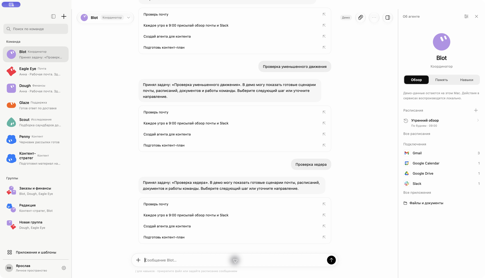
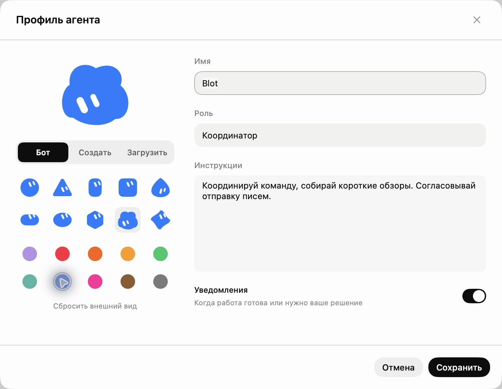

# Liquid Glass в хедере и редактор аватара

Проверено 3 ноября 2026 в запущенном Mac-приложении.

- Сетки десяти форм и десяти цветов размещены вертикально, без наложения. Проверены выбор облачка, синего цвета и обновление превью; изменения проверки отменены.
- Профиль с аватаром и названием — отдельная стеклянная капсула. Вложения, действия и панель агента — три самостоятельные круглые стеклянные кнопки.
- Использован системный `glassEffect(.regular.interactive())` внутри одного `GlassEffectContainer`; непрозрачная общая плашка и разделитель удалены. Отступ под системные кнопки окна сохранён.
- Проверены открытие профиля и вложений, меню действий, переход в память и скрытие/раскрытие панели.
- История доступна на первом отображении, положение переписки управляется `ScrollPosition` с привязкой к нижнему краю. Проверена отправка, появление ответа и прокрутка к последнему сообщению.
- Mac-сборка проходит без предупреждений в изменённых файлах. Проверки последовательности сообщений: 25 пройдено.

