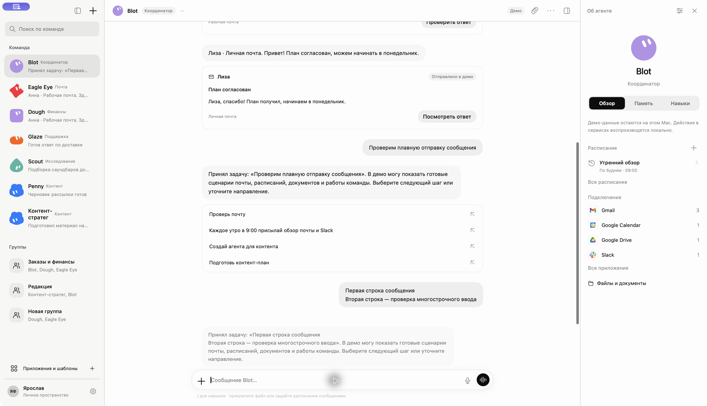
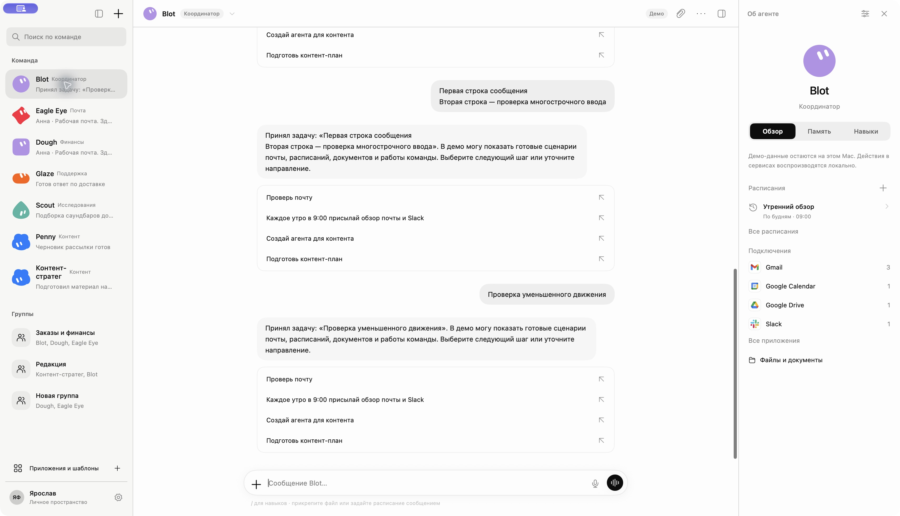

# Появление сообщений в стиле iMessage

Проверено 3 ноября 2026 в запущенной Mac-сборке.

Исходящий пузырь перемещается от измеренного положения поля ввода к своему месту в переписке, слегка раскрываясь с пружиной. Демо-ответ начинает появляться через 300 мс: раскрывается от нижнего левого края, а предыдущие сообщения плавно сдвигаются. Ответы группы могут последовательно появляться с интервалом 180 мс.

Анимация отделена от сохранения: сообщения и ответы сразу записываются в демо, временно откладывается только показ ответа. Повторная отправка сохраняет порядок сообщений; отмена задачи при обновлении не теряет ожидающие ответы. При открытии чата сохранённая история появляется сразу. Чтение старых сообщений не прерывается прокруткой от нового входящего сообщения. Уменьшение движения убирает перемещение и ожидание.

Проверено в интерфейсе:

- Отправка короткого и многострочного текста клавишей Return, очистка поля и сохранение фокуса.
- Появление ответа и завершение прокрутки без наложения сообщений.
- Отправка при включённом уменьшении движения; после проверки анимации снова включены.
- Переход в другой чат и возврат без повторной анимации сохранённых сообщений.

22 проверки последовательности проходят: история, порядок отправки и ответа, быстрые повторные отправки, повторная синхронизация после отмены задачи, отсутствие дублей, удаление исчезнувших идентификаторов, уменьшение движения и возврат в чат. Mac-приложение собрано и запущено без предупреждений компилятора в затронутых файлах.

Повторить проверки из корня проекта:

```sh
mkdir -p .build/mac-demo-check/module-cache
xcrun swiftc -parse-as-library -module-cache-path .build/mac-demo-check/module-cache \
  apps/macos/BlotMac/Features/TeamDesign/Domain/MacDemoModels.swift \
  apps/macos/BlotMac/Features/TeamDesign/MacTeamMessageTimeline.swift \
  scripts/verify-mac-message-timeline.swift -o .build/mac-demo-check/message-timeline
.build/mac-demo-check/message-timeline
```

Скриншоты показывают фактические состояния приложения; точная длительность анимации по статическим кадрам не измерялась.




