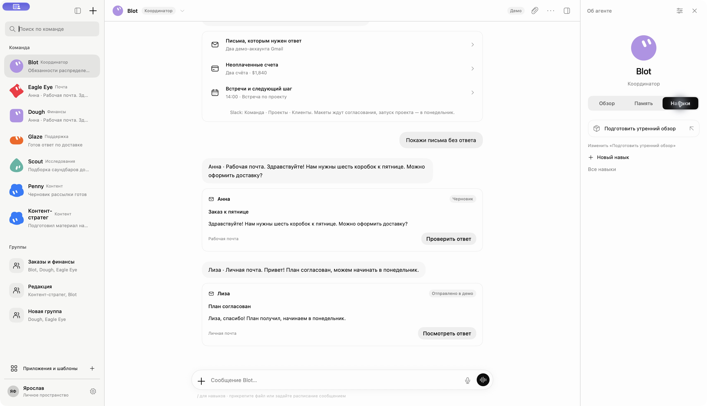
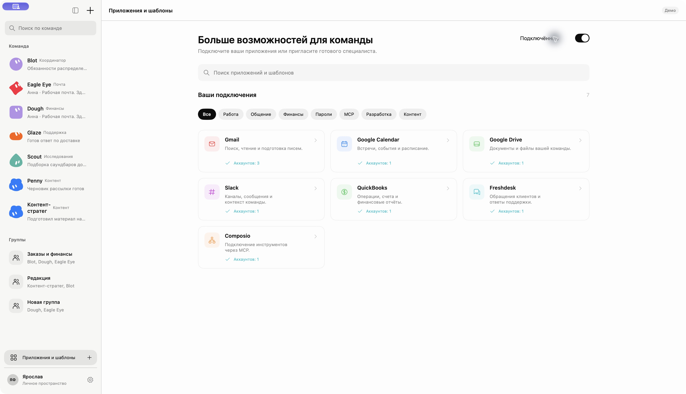
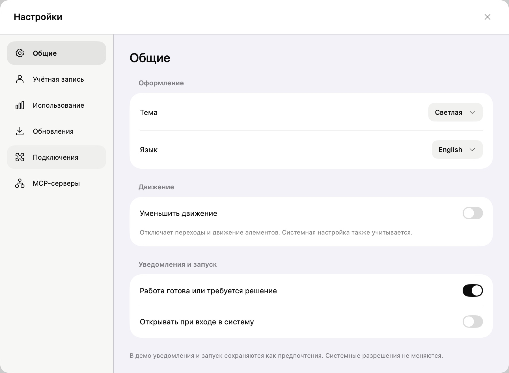

# Анимации и единые иконки Mac

Проверено 3 ноября 2026.

- Mac-приложение собрано и запущено с `--team-design`.
- iPhone-приложение собрано для iOS Simulator; остаются существующие предупреждения в PhoneProfileEditor и PhoneAuthenticationView.
- Общая библиотека BlotDesign: 24 теста в 6 наборах проходят, включая соответствия иконок.
- Проверены все 101 SVG: наличие ресурса для каждого BlotGlyph, сетка 24×24, штрих 1.6, круглые окончания/соединения и шаблонная окраска.
- 53 статических ключа иконок Mac-интерфейса разрешаются через общий каталог. Прямых Image(systemName:) и systemImage: в TeamDesign нет.
- В приложении проверены вкладки инспектора, скрытие/раскрытие панелей, переход в каталог, фильтр подключённых приложений, вкладки настроек и включение/выключение уменьшения движения. После проверки движение включено.
- Статические скриншоты показывают итоговую компоновку и иконки; длительность анимаций по ним не измеряется.

